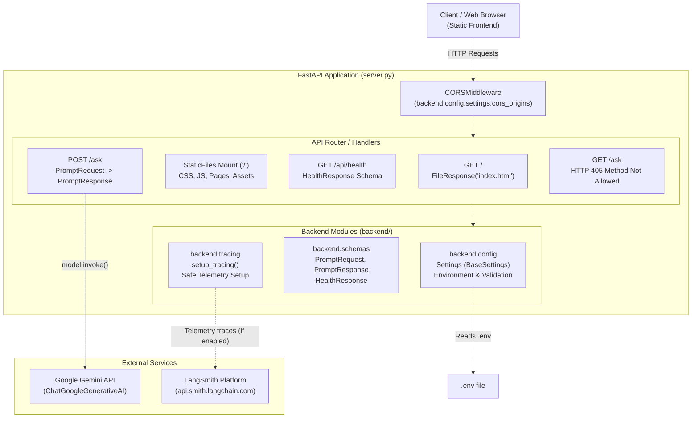
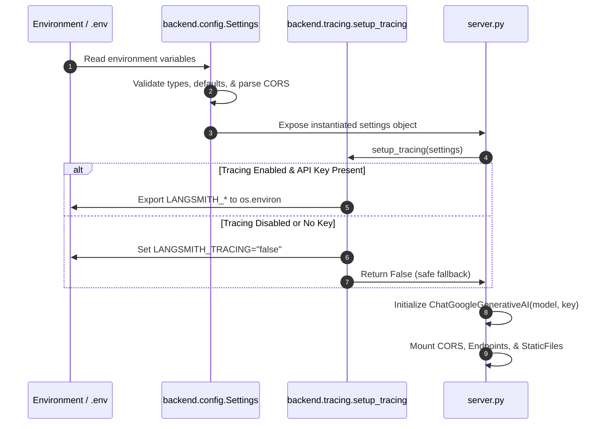

# Phase 1: Backend Architecture & System Design

This document describes the architectural layout, component responsibilities, request lifecycle, and data flow established in **Phase 1: Backend Foundation & Infrastructure** of **Octs AI**.

---

## Table of Contents

- [Architectural Overview](#architectural-overview)
- [System Architecture Diagram](#system-architecture-diagram)
- [Directory Layout](#directory-layout)
- [Module Responsibilities](#module-responsibilities)
  - [1. server.py](#1-serverpy)
  - [2. backend/config.py](#2-backendconfigpy)
  - [3. backend/schemas.py](#3-backendschemaspy)
  - [4. backend/tracing.py](#4-backendtracingpy)
- [Configuration Lifecycle & Data Flow](#configuration-lifecycle--data-flow)
- [Request-Response Lifecycle](#request-response-lifecycle)
  - [Health Check (`GET /api/health`)](#health-check-get-apihealth)
  - [Prompt Generation (`POST /ask`)](#prompt-generation-post-ask)
  - [Method Guard (`GET /ask`)](#method-guard-get-ask)
  - [Static Asset Serving (`GET /`)](#static-asset-serving-get-)
- [Google Gemini Integration](#google-gemini-integration)
- [LangSmith Tracing Initialization](#langsmith-tracing-initialization)
- [Current vs. Future State Boundaries](#current-vs-future-state-boundaries)

---

## Architectural Overview

Phase 1 establishes a modular, decoupled backend foundation built upon **FastAPI** and **Pydantic Settings**, replacing a previously monolithic single-file design.

The system emphasizes:
1. **Separation of Concerns**: Isolated modules for configuration, schemas, telemetry, and web routing.
2. **Defensive Validation**: Strict type checking and bounds enforcement on all inputs and configurations.
3. **Safe Observability**: Non-blocking telemetry initialization that never halts local execution.
4. **Preserved Contracts**: Total backward compatibility with the existing static frontend.

---

## System Architecture Diagram



---

## Directory Layout

The Phase 1 backend codebase is organized as follows:

```text
Octs/
├── server.py                   # Main FastAPI application & route definitions
├── requirements.txt            # Python dependencies (pinned with compatible bounds)
├── .env.example                # Canonical template for environment variables
├── .env                        # Local runtime secrets (untracked)
├── backend/                    # Core backend package
│   ├── __init__.py             # Package declaration & version (0.2.0)
│   ├── config.py               # Pydantic Settings & environment validation
│   ├── schemas.py              # Pydantic request/response data contracts
│   ├── tracing.py              # LangSmith observability & telemetry initializer
│   └── tests/                  # Automated pytest suite
│       ├── __init__.py
│       ├── test_config.py      # Configuration & validation tests (5 tests)
│       └── test_api.py         # Endpoint & contract tests (10 tests)
├── css/                        # Frontend stylesheets (preserved)
├── js/                         # Frontend scripts (preserved)
├── pages/                      # Frontend HTML views (preserved)
├── index.html                  # Frontend entry point (preserved)
└── Phases/
    └── Phase 1/                # Phase 1 documentation
        ├── README.md
        ├── ARCHITECTURE.md
        ├── API_REFERENCE.md
        ├── CONFIGURATION.md
        ├── TESTING.md
        ├── IMPLEMENTATION_LOG.md
        └── DECISIONS.md
```

---

## Module Responsibilities

### 1. `server.py`
The web server entry point initialized by Uvicorn.
- **Application Assembly**: Instantiates the `FastAPI` application with title `Octs AI API` and version `0.2.0`.
- **CORS Configuration**: Configures `CORSMiddleware` using `settings.cors_origins` parsed from `backend.config`.
- **Telemetry Hook**: Calls `setup_tracing(settings)` during initialization to register LangSmith environment variables safely.
- **Model Instantiation**: Initializes `ChatGoogleGenerativeAI` using `settings.model_name`, `settings.model_temperature`, and `settings.gemini_api_key`.
- **Route Definitions**:
  - `GET /`: Serves `index.html`.
  - `GET /api/health`: Provides JSON system status.
  - `POST /ask`: Primary inference route validating `PromptRequest` and returning `PromptResponse`.
  - `GET /ask`: Defensive fallback returning HTTP 405.
- **Static Mounting**: Mounts `StaticFiles(directory=".")` to serve `css/`, `js/`, and `pages/`.

### 2. `backend/config.py`
Manages centralized application configuration using Pydantic Settings (`BaseSettings`).
- **Typed Attributes**:
  - `gemini_api_key`: Optional string loaded from environment.
  - `model_name`: String default `"gemini-3.5-flash-lite"`.
  - `model_provider`: String default `"google_genai"`.
  - `model_temperature`: Float default `0.0`.
  - `langsmith_tracing`: Boolean default `False`.
  - `langsmith_api_key`: Optional string.
  - `langsmith_project`: String default `"octs-ai"`.
  - `langsmith_endpoint`: URL default `"https://api.smith.langchain.com"`.
  - `cors_origins`: Parsed list of origins (handles comma-separated strings from environment).
  - `allowed_disciplines`: Whitelist set `{"writers", "musicians", "creators", "designers"}`.
  - `max_recursion_limit`: Integer default `15`.
  - `max_recovery_attempts`: Integer default `2`.
  - `max_prompt_length`: Integer default `50000`.
- **Environment Loading**: Automatically reads from `.env` via `SettingsConfigDict(env_file=".env", extra="ignore")`.

### 3. `backend/schemas.py`
Defines data structures using Pydantic `BaseModel` for validation, serialization, and OpenAPI documentation.
- **`PromptRequest`**:
  - `prompt`: String with minimum length 1, maximum 50,000 characters, whitespace-stripped.
  - `role`: String indicating creative discipline (default `"general"`). Validated against `writers`, `musicians`, `creators`, `designers`, `general`.
  - `session_id`: Optional session identifier string.
- **`PromptResponse`**:
  - `reply`: String response content (guarantees backward compatibility with frontend).
  - `role`: Role applied for inference.
  - `agent_used`: Identifier of the agent persona (e.g., `"direct_model"` in Phase 1).
  - `trust_score`: Optional float for output confidence/craft score.
  - `trust_breakdown`: Optional dictionary of evaluation components.
  - `latency_ms`: Float execution duration in milliseconds.
  - `recovery_triggered`: Boolean indicating if self-correction was executed.
  - `model_used`: String model identifier.
- **`HealthResponse`**:
  - `status`: Health state (`"ok"`).
  - `version`: Server version (`"0.2.0"`).
  - `model_provider`: Active provider name (`"google_genai"`).
  - `model_name`: Active model identifier.
  - `langsmith_tracing`: Boolean tracing status.

### 4. `backend/tracing.py`
Encapsulates LangSmith observability setup.
- **Safe Initialization**: Checks if `settings.langsmith_tracing` is enabled and a valid `settings.langsmith_api_key` is present.
- **Environment Propagation**: Populates `LANGSMITH_TRACING`, `LANGSMITH_API_KEY`, `LANGSMITH_PROJECT`, and `LANGSMITH_ENDPOINT` into `os.environ` so LangChain internal hooks automatically capture traces.
- **Graceful Fallback**: If disabled or key is absent, sets `LANGSMITH_TRACING="false"` and logs an informative message without raising exceptions.

---

## Configuration Lifecycle & Data Flow



---

## Request-Response Lifecycle

### Health Check (`GET /api/health`)
1. Client issues `GET /api/health`.
2. Handler builds and returns `HealthResponse` populated from `settings`.
3. Client receives JSON payload with HTTP 200 OK.

### Prompt Generation (`POST /ask`)
1. Client issues `POST /ask` with JSON `{ "prompt": "...", "role": "writers" }`.
2. FastAPI validates body against `PromptRequest`:
   - Enforces $1 \le \text{length} \le 50,000$.
   - Rejects empty or whitespace-only prompts with HTTP 422 Unprocessable Entity.
   - Normalizes role to lowercase and validates against allowed discipline list.
3. Timestamp recorded ($t_{\text{start}}$).
4. Direct model invocation via `model.invoke(prompt)`.
5. Timestamp recorded ($t_{\text{end}}$), computing `latency_ms = (t_end - t_start) * 1000`.
6. Handler builds `PromptResponse` returning HTTP 200 OK containing both the legacy `reply` field and modern metadata fields (`latency_ms`, `agent_used`, `model_used`).

### Method Guard (`GET /ask`)
1. Browser or client accidentally issues `GET /ask`.
2. Guard handler intercepts the request and returns HTTP 405 Method Not Allowed with JSON:
   ```json
   {
     "status": "error",
     "message": "The /ask endpoint requires an HTTP POST request with a JSON body: {\"prompt\": \"...\", \"role\": \"...\"}."
   }
   ```

### Static Asset Serving (`GET /`)
1. Client requests `GET /`.
2. `server.py` returns `FileResponse("index.html")`.
3. Subsequent requests for `/css/*`, `/js/*`, or `/pages/*` are resolved by the mounted `StaticFiles` provider.

---

## Google Gemini Integration

Phase 1 utilizes LangChain's official Google GenAI integration:
- **Module**: `langchain_google_genai.ChatGoogleGenerativeAI`
- **Default Model**: `gemini-3.5-flash-lite`
- **Temperature**: `0.0` (deterministic outputs suitable for creative craft analysis)
- **Authentication**: `GEMINI_API_KEY` provided via `.env` or system environment. Both `GEMINI_API_KEY` and `GOOGLE_API_KEY` are synchronized in `server.py` to prevent provider authentication ambiguity.

---

## LangSmith Tracing Initialization

Telemetry tracing is initialized without blocking application startup:
- Tracing is active **only if** both `LANGSMITH_TRACING=true` and `LANGSMITH_API_KEY` are configured.
- When enabled, LangChain hooks stream run metadata, latency, and prompt traces directly to the configured `LANGSMITH_PROJECT` on `https://api.smith.langchain.com`.
- When disabled, no external network requests or logging penalties are incurred.

---

## Current vs. Future State Boundaries

To maintain technical accuracy, the system boundaries of Phase 1 are explicitly delineated from future phases:

| Feature / Capability | Phase 1 (Current) | Phase 2 (Planned) |
| :--- | :--- | :--- |
| **Model Invocation** | Direct `model.invoke()` | LangGraph state graph execution |
| **Agent Personas** | Single fallback identifier (`direct_model`) | 4 discipline agents + 16 specialist personas |
| **Orchestration** | Linear request-response | Cyclic graph with self-correction & recovery |
| **State Persistence** | None (stateless HTTP) | SQLite checkpointing (`thread_id` scoped) |
| **TrustScore** | Static placeholder (`None`) | Rule-based craft evaluation & adherence scoring |
| **Configuration** | Pydantic Settings | Pydantic Settings + Agent Graph configs |
| **Frontend Integration** | HTTP JSON (`{ "reply": "..." }`) | Streaming + Structured JSON breakdown |
