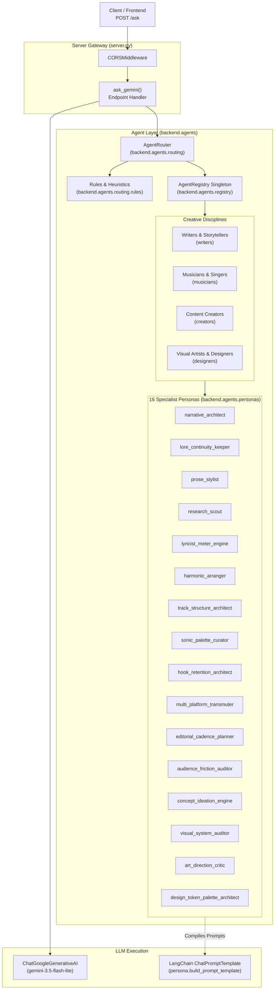
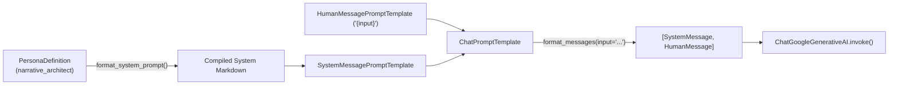
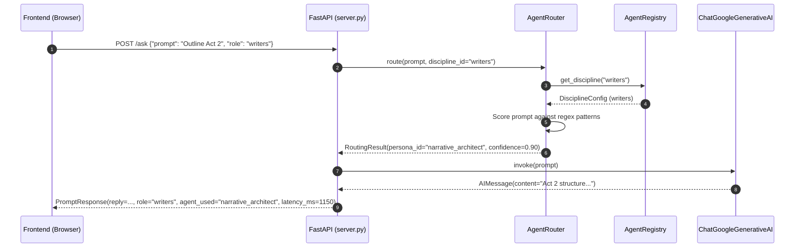

# Phase 2: Agent Persona Layer Architecture & System Design

This document details the architectural layout, class relationships, LangChain abstractions, and data flow established in **Phase 2: Discipline Hierarchy & Agent Persona Layer** of **Octs AI**.

---

## Table of Contents

- [Architectural Overview](#architectural-overview)
- [System Architecture Diagram](#system-architecture-diagram)
- [Directory Layout](#directory-layout)
- [Class & Component Design](#class--component-design)
  - [1. PersonaDefinition](#1-personadefinition)
  - [2. DisciplineConfig](#2-disciplineconfig)
  - [3. ModelConfig](#3-modelconfig)
  - [4. AgentRegistry (Singleton)](#4-agentregistry-singleton)
  - [5. AgentRouter & Rules Engine](#5-agentrouter--rules-engine)
- [LangChain Compatibility & Prompt Compilation](#langchain-compatibility--prompt-compilation)
- [Request Lifecycle Sequence Diagram](#request-lifecycle-sequence-diagram)
- [Boundary: Phase 2 vs. Phase 3 (LangGraph)](#boundary-phase-2-vs-phase-3-langgraph)

---

## Architectural Overview

Phase 2 introduces a domain-specialized, decoupled agent layer between the HTTP gateway (`server.py`) and underlying LLM invocations.

The architecture is built on three core design tenets:
1. **Strong Typing & Immutability**: All personas, disciplines, and routing objects are strictly validated with **Pydantic v2**, preventing runtime attribute errors.
2. **Centralized Discovery**: A singleton registry (`AgentRegistry`) serves as the single source of truth for all 4 creative disciplines and 16 specialist personas.
3. **Deterministic First Routing**: The routing engine prioritizes explicit task matching and regex heuristics over opaque model calls, ensuring high predictability, sub-millisecond execution, and zero hallucinations.

---

## System Architecture Diagram



---

## Directory Layout

The agent layer is structured under `backend/agents/`:

```text
backend/agents/
├── __init__.py                # Package exports: base models, registry, router
├── base.py                    # Unified Pydantic v2 schemas: PersonaDefinition, DisciplineConfig, RoutingResult
├── registry.py                # AgentRegistry singleton & registration routines
├── disciplines/               # Discipline definitions
│   ├── __init__.py
│   ├── writers.py             # Writers & Storytellers
│   ├── musicians.py           # Musicians & Singers
│   ├── creators.py            # Content Creators
│   └── designers.py           # Visual Artists & Designers
├── personas/                  # 16 Specialized Personas
│   ├── __init__.py
│   ├── narrative_architect.py
│   ├── lore_continuity_keeper.py
│   ├── prose_stylist.py
│   ├── research_scout.py
│   ├── lyricist_meter_engine.py
│   ├── harmonic_arranger.py
│   ├── track_structure_architect.py
│   ├── sonic_palette_curator.py
│   ├── hook_retention_architect.py
│   ├── multi_platform_transmuter.py
│   ├── editorial_cadence_planner.py
│   ├── audience_friction_auditor.py
│   ├── concept_ideation_engine.py
│   ├── visual_system_auditor.py
│   ├── art_direction_critic.py
│   └── design_token_palette_architect.py
└── routing/                   # Task routing and classification
    ├── __init__.py
    ├── rules.py               # Pattern dictionaries, task mappings, scoring heuristics
    └── classifier.py          # AgentRouter with 4-stage pipeline
```

---

## Class & Component Design

### 1. `PersonaDefinition`
Defined in `backend/agents/base.py`, this class encapsulates all craft specifications for a specialist persona:

```python
class PersonaDefinition(BaseModel):
    id: str                               # e.g., 'narrative_architect'
    display_name: str                     # e.g., 'Narrative Architect'
    discipline_id: str                    # 'writers' | 'musicians' | 'creators' | 'designers'
    description: str                      # High-level craft focus
    primary_responsibilities: List[str]   # Core technical functions owned
    supported_task_types: List[str]       # Supported task classifications
    system_instructions: str              # Specialized system prompt
    domain_constraints: List[str]         # Strict craft rules and anti-patterns
    expected_output_structure: List[str]  # Standardized markdown headers
    evaluation_criteria: List[str]        # Craft quality benchmarks
    model_config_recommendation: ModelConfig  # Recommended temperature/tokens
    available_tool_permissions: List[str] # Tool authorization identifiers
```

#### Key Methods:
- `format_system_prompt() -> str`: Compiles role description, directives, responsibilities, constraints, output structure, and evaluation criteria into a cohesive markdown document.
- `build_prompt_template() -> ChatPromptTemplate`: Generates a LangChain `ChatPromptTemplate` pairing the compiled system message with a human message placeholder `{input}`.

### 2. `DisciplineConfig`
Governs discipline-wide configuration, scope, and relationships:

```python
class DisciplineConfig(BaseModel):
    id: str                               # e.g., 'writers'
    display_name: str                     # e.g., 'Writers & Storytellers'
    purpose: str                          # Core mission
    scope: str                            # Creative operations supported
    specialist_persona_ids: List[str]     # Exact 4 specialist IDs
    supported_task_categories: List[str]  # High-level task categories
    discipline_terminology: List[str]     # Domain vocabulary
    quality_requirements: List[str]       # Quality benchmarks
    default_output_conventions: List[str] # Standard formatting rules
```

#### Key Methods:
- `get_personas() -> List[PersonaDefinition]`: Queries `AgentRegistry` to retrieve instantiated persona objects.

### 3. `ModelConfig`
Encapsulates recommended LLM parameters per persona:
- `model_name`: Optional string override.
- `temperature`: Bounded float ($0.0 \le t \le 2.0$), tailored to the persona's need for precision (e.g. $0.1$ for `lore_continuity_keeper`, $0.6$ for `concept_ideation_engine`).
- `top_p`: Nucleus sampling threshold (default $0.95$).
- `max_output_tokens`: Maximum token budget (default $4096$).

### 4. `AgentRegistry` (Singleton)
Instantiated via `get_registry()` in `backend/agents/registry.py`:
- Populated with all 4 disciplines and 16 personas upon initial import.
- Provides $O(1)$ lookups via `.get_persona(id)` and `.get_discipline(id)`.
- Supports case-insensitive and whitespace-tolerant lookups.
- Provides listing methods: `.list_disciplines()`, `.list_personas()`, and `.get_personas_for_discipline(disc_id)`.

### 5. `AgentRouter` & Rules Engine
Implements the 4-stage routing pipeline in `backend/agents/routing/`:
1. **Explicit Task Mapping**: Checks `task_type` against `TASK_TYPE_MAPPING`. If matched and valid for the discipline, returns with confidence `0.95`.
2. **Deterministic Pattern Scoring**: Evaluates prompt against pre-compiled regex patterns in `PERSONA_PATTERNS`. If matches exist, returns highest-scoring persona with confidence `0.65 - 0.92` and sets `alternative_persona_id` if a runner-up scored.
3. **Model-Assisted Classification**: If a model is provided and prompt is ambiguous, queries model for a structured persona ID, validates it against the discipline's allowed personas, and safely returns with confidence `0.85`.
4. **Discipline Default Fallback**: If all else fails or model throws an exception, safely falls back to the discipline's primary persona (`DEFAULT_PERSONAS[discipline]`) with confidence `0.50`.

---

## LangChain Compatibility & Prompt Compilation

Phase 2 uses standard LangChain abstractions:



This design separates prompt authoring and craft constraints from runtime model invocation, ensuring complete portability for future LangGraph execution nodes.

---

## Request Lifecycle Sequence Diagram



---

## Boundary: Phase 2 vs. Phase 3 (LangGraph)

| Responsibility / Feature | Phase 2 (Completed) | Phase 3 (Planned) |
| :--- | :--- | :--- |
| **Persona Definitions** | Formalized in `backend/agents/personas/` | Reused as execution node templates |
| **Prompt Structures** | `ChatPromptTemplate` compilation ready | Bound to LangGraph StateGraph nodes |
| **Routing** | Synchronous `AgentRouter` | Conditional edge routing in LangGraph |
| **Execution Loop** | Single-turn request-response | Cyclic graph with reflection & recovery |
| **State Persistence** | Stateless per HTTP request | SQLite checkpointing with `thread_id` |
| **TrustScore** | Placeholder (`None`) | Node-level craft evaluation |
