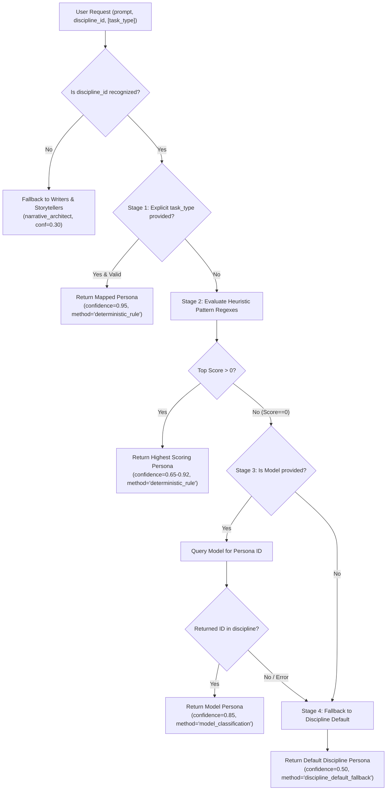

# Phase 2: Agent Task Routing & Classification Guide

This document describes the routing architecture, decision pipeline, heuristic scoring heuristics, and fallback mechanisms implemented in `backend/agents/routing/` for **Octs AI**.

---

## Table of Contents

- [Routing Philosophy](#routing-philosophy)
- [The 4-Stage Routing Pipeline](#the-4-stage-routing-pipeline)
  - [Stage 1: Explicit Task Type Mapping](#stage-1-explicit-task-type-mapping)
  - [Stage 2: Deterministic Heuristic Pattern Scoring](#stage-2-deterministic-heuristic-pattern-scoring)
  - [Stage 3: Model-Assisted Classification (Optional/Ambiguous)](#stage-3-model-assisted-classification-optionalambiguous)
  - [Stage 4: Discipline Default Fallback](#stage-4-discipline-default-fallback)
- [Pattern Matching Engine (`rules.py`)](#pattern-matching-engine-rulespy)
- [Confidence Scoring Formula](#confidence-scoring-formula)
- [Alternative Persona Recommendation](#alternative-persona-recommendation)
- [Safety & Guardrails](#safety--guardrails)
- [Routing Verification Matrix](#routing-verification-matrix)

---

## Routing Philosophy

In production multi-agent systems, routing tasks to specialized agents must be **deterministic, fast, and fail-safe**.
- **No Hallucinated Personas**: An unvetted or arbitrary persona string must never reach execution.
- **Sub-Millisecond Heuristic Path**: In >95% of typical creative inquiries, regex pattern scoring assigns the persona in under 1 millisecond without incurring external LLM API latency or token costs.
- **Graceful Degradation**: If an input is vague or a downstream classifier fails, the system always resolves to a sensible discipline lead specialist rather than raising unhandled exceptions.

---

## The 4-Stage Routing Pipeline

The routing engine is encapsulated in `AgentRouter.route()` (`backend/agents/routing/classifier.py`):



---

### Stage 1: Explicit Task Type Mapping
When an API client or upstream component provides an explicit `task_type` parameter, the router checks `TASK_TYPE_MAPPING`:
- If the task type matches a registered specialist persona **and** that persona belongs to the selected discipline, routing resolves immediately.
- **Confidence**: `0.95`
- **Method**: `"deterministic_rule"`
- **Example Rationale**: *"Selected Lore & Continuity Keeper based on explicit task categorization 'worldbuilding_audit'."*

### Stage 2: Deterministic Heuristic Pattern Scoring
If `task_type` is omitted or unmapped, the router evaluates the user prompt against the discipline's regex patterns (`PERSONA_PATTERNS`):
- High-signal keywords, technical terms, and multi-word phrases (e.g. `\bmodal interchange\b`, `\bgestalt\b`, `\bthree-act\b`) are counted.
- Scores are tabulated across all 4 personas in the active discipline.
- If the top score $> 0$, the highest-scoring persona is selected.
- **Confidence**: Scaled between `0.65` and `0.92` based on match count and margin of victory over the runner-up.
- **Method**: `"deterministic_rule"`

### Stage 3: Model-Assisted Classification (Optional/Ambiguous)
If heuristic scoring yields zero matches (the prompt contains no recognizable craft vocabulary) and a model instance is supplied:
- The router invokes a structured classification prompt presenting the exact four persona IDs and descriptions for that discipline.
- The model response is parsed and strictly validated against the discipline's registered personas.
- If the model returns a hallucinated ID, garbage text, or raises an API timeout/exception, Stage 3 is bypassed without raising errors.
- **Confidence**: `0.85`
- **Method**: `"model_classification"`

### Stage 4: Discipline Default Fallback
If the prompt remains unclassified after stages 1–3, the router selects the primary lead persona for that discipline:
- `writers` $\rightarrow$ `narrative_architect`
- `musicians` $\rightarrow$ `track_structure_architect`
- `creators` $\rightarrow$ `hook_retention_architect`
- `designers` $\rightarrow$ `concept_ideation_engine`
- **Confidence**: `0.50`
- **Method**: `"discipline_default_fallback"`

---

## Pattern Matching Engine (`rules.py`)

The pattern dictionary `PERSONA_PATTERNS` defines word-boundary regexes tailored to creative domain jargon:

### Writers Example
```python
"writers": {
    "narrative_architect": [
        r"\bplot\b", r"\boutline\b", r"\bact\b", r"\bstructure\b", r"\barc\b",
        r"\bpacing\b", r"\binciting incident\b", r"\bclimax\b", r"\bturning point\b",
        r"\bbeat sheet\b", r"\bhero'?s journey\b", r"\bthree[- ]act\b",
    ],
    "lore_continuity_keeper": [
        r"\blore\b", r"\bworldbuilding\b", r"\bmagic system\b", r"\btimeline\b",
        r"\bcanon\b", r"\bcontinuity\b", r"\bchronology\b", r"\bparadox\b",
    ],
    # ...
}
```

---

## Confidence Scoring Formula

In Stage 2, confidence ($C$) is calculated dynamically using the formula:

$$C = \min\left(0.92, \; 0.65 + (S_{\text{top}} \times 0.05) + ((S_{\text{top}} - S_{\text{runner\_up}}) \times 0.05)\right)$$

Where:
- $S_{\text{top}}$ is the raw match score of the highest-ranking persona.
- $S_{\text{runner\_up}}$ is the score of the second-highest persona ($0.0$ if none).
- A minimum confidence of $0.65$ is guaranteed for any positive match.
- An upper bound of $0.92$ prevents heuristics from claiming unwarranted certainty.

---

## Alternative Persona Recommendation

When user creative requests span multiple specialties (e.g., *"Help me structure the plot and polish the prose"*):
- Both `narrative_architect` and `prose_stylist` score positive matches.
- The highest-ranking persona becomes `persona_id`.
- The second-highest persona is attached as `alternative_persona_id`.
- This enables future multi-agent workflows (Phase 3) to execute collaborative multi-persona reviews.

---

## Safety & Guardrails

| Risk Scenario | Protection Mechanism | Result |
| :--- | :--- | :--- |
| **Invalid Discipline** | Input checked against `registry.get_discipline()` | Safely defaults to `writers` and `narrative_architect` ($C=0.30$). |
| **Hallucinated Persona ID** | Model classification output validated against persona list | Hallucinations discarded; falls back to discipline default. |
| **Model API Quota/Error** | `try...except` wrapper around `model.invoke()` | Silently catches errors; falls back to Stage 4. |
| **Prompt Injection** | Routing uses strict regex tokens or structured extraction | User prompt is never executed as routing instructions. |
| **Private CoT Leakage** | Router output contains only clean user-facing rationales | Internal model reasoning tokens are discarded. |

---

## Routing Verification Matrix

The following test suite (`backend/tests/test_agent_routing.py`) validates routing across representative tasks:

| Prompt Query | Discipline | Routed Specialist | Conf | Routing Method |
| :--- | :--- | :--- | :--- | :--- |
| *"I need help designing a three-act plot outline and pacing the climax."* | `writers` | `narrative_architect` | $0.90$ | `deterministic_rule` |
| *"Check my story bible and magic system rules for continuity contradictions."* | `writers` | `lore_continuity_keeper` | $0.90$ | `deterministic_rule` |
| *"Polish this dialogue scene to add subtext and remove purple prose."* | `writers` | `prose_stylist` | $0.85$ | `deterministic_rule` |
| *"What were authentic forensic procedures in the late 19th century?"* | `writers` | `research_scout` | $0.80$ | `deterministic_rule` |
| *"Help me write lyrics with tight rhyme scheme, meter, and vocal hooks."* | `musicians` | `lyricist_meter_engine` | $0.90$ | `deterministic_rule` |
| *"Design a chord progression using modal interchange and smooth voice leading."* | `musicians` | `harmonic_arranger` | $0.85$ | `deterministic_rule` |
| *"How do I arrange song structure with dynamic energy curves into the drop?"* | `musicians` | `track_structure_architect` | $0.85$ | `deterministic_rule` |
| *"What synth patch textures slot frequencies between 808 and vocal?"* | `musicians` | `sonic_palette_curator` | $0.85$ | `deterministic_rule` |
| *"Create high-retention video hook for first 3 seconds to prevent drop-off."* | `creators` | `hook_retention_architect` | $0.85$ | `deterministic_rule` |
| *"Repurpose longform video transcript into X thread and LinkedIn post."* | `creators` | `multi_platform_transmuter` | $0.85$ | `deterministic_rule` |
| *"Build a 30-day editorial content calendar and batching production schedule."* | `creators` | `editorial_cadence_planner` | $0.80$ | `deterministic_rule` |
| *"Audit landing page script for cognitive friction, jargon, and CTAs."* | `creators` | `audience_friction_auditor` | $0.85$ | `deterministic_rule` |
| *"Brainstorm divergent visual concepts and moodboard metaphors."* | `designers` | `concept_ideation_engine` | $0.85$ | `deterministic_rule` |
| *"Audit UI layout for grid alignment, Gestalt hierarchy, and padding."* | `designers` | `visual_system_auditor` | $0.90$ | `deterministic_rule` |
| *"Provide a critique on lighting, atmospheric depth, and composition."* | `designers` | `art_direction_critic` | $0.85$ | `deterministic_rule` |
| *"Generate semantic design tokens palette passing WCAG 2.2 AAA."* | `designers` | `design_token_palette_architect` | $0.85$ | `deterministic_rule` |
| *"Hello, I want to create something nice today."* (Ambiguous) | `designers` | `concept_ideation_engine` | $0.50$ | `discipline_default_fallback` |
