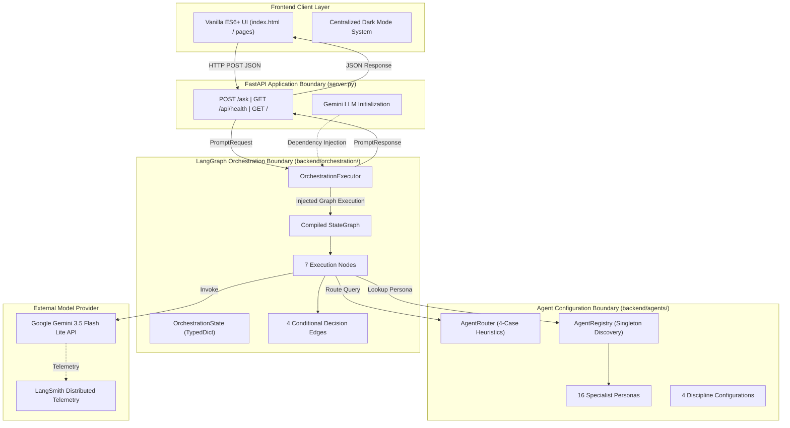
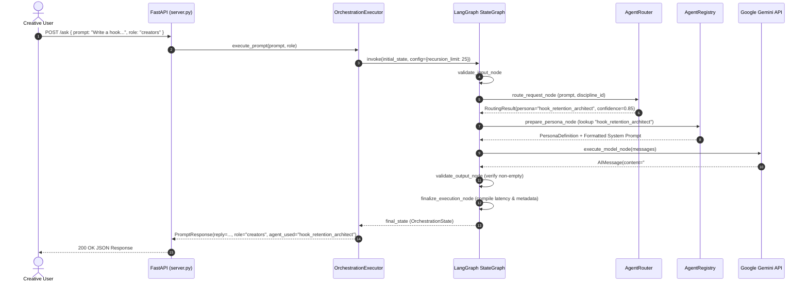

# Phase 3 Architecture: LangGraph Multi-Agent Orchestration

This document details the architectural design of **Phase 3** of **Octs AI**, explaining the integration of LangGraph, the modular orchestration subsystems, explicit dependency injection, application boundaries, and the evolutionary relationship between Phases 1, 2, and 3.

---

## Table of Contents

- [Architectural Overview](#architectural-overview)
- [Evolutionary Relationship: Phases 1, 2, and 3](#evolutionary-relationship-phases-1-2-and-3)
- [System Architecture & Module Boundaries](#system-architecture--module-boundaries)
- [Orchestration Subsystem Modules](#orchestration-subsystem-modules)
- [Dependency Injection Pattern](#dependency-injection-pattern)
- [Single Shared Pipeline Paradigm](#single-shared-pipeline-paradigm)
- [Intelligent Ambiguity & Clarification Architecture](#intelligent-ambiguity--clarification-architecture)
- [Execution Lifecycle & Data Flow](#execution-lifecycle--data-flow)

---

## Architectural Overview

Octs AI is designed as an agentic AI harness rather than a basic conversational chatbot. In Phase 3, the backend replaces direct model calls with a **stateful, graph-based execution workflow** powered by **LangGraph 0.2+**.

Key architectural tenets:
1. **Separation of Concerns**: API routing, agent configuration, workflow orchestration, and model execution reside in isolated layers with clear interfaces.
2. **Explicit Dependency Injection**: Nodes and executors receive their required services (LLM, router, registry) through constructor and parameter injection, eliminating global module couplings.
3. **Deterministic State Transitions**: State transitions are governed by typed data structures (`OrchestrationState`) and conditional edges that handle validation, fallback, short-circuit clarification, and recovery.
4. **Single Shared Graph**: All 16 creative specialist personas execute through one unified StateGraph, preventing combinatorial workflow sprawl.

---

## Evolutionary Relationship: Phases 1, 2, and 3

```
+------------------------------------------------------------------------+
| PHASE 1: Backend Foundation & Infrastructure                           |
| - FastAPI Server & Pydantic v2 Schemas                                 |
| - Gemini 3.5 Flash Lite Provider via langchain-google-genai            |
| - Settings & Environment Configuration (backend/config.py)             |
| - LangSmith Tracing Hooks (backend/tracing.py)                         |
+-----------------------------------+------------------------------------+
                                    | Foundation & Schemas
                                    v
+------------------------------------------------------------------------+
| PHASE 2: Discipline Hierarchy & Specialist Persona Layer               |
| - 4 Disciplines: Writers, Musicians, Creators, Designers               |
| - 16 Specialist Persona Modules with Deep Craft Constraints           |
| - Central Agent Registry (backend/agents/registry.py)                  |
| - Deterministic Task Routing Engine (backend/agents/routing/)          |
+-----------------------------------+------------------------------------+
                                    | Personas & Routing Heuristics
                                    v
+------------------------------------------------------------------------+
| PHASE 3: LangGraph Multi-Agent Orchestration & Refinement              |
| - Unified StateGraph Pipeline (backend/orchestration/graph.py)         |
| - Typed Orchestration State (backend/orchestration/state.py)           |
| - 7 Graph Nodes & 4 Conditional Decision Edges                        |
| - Model Dependency Injection & Server Decoupling                       |
| - 4-Case Routing Engine with Zero-Token Clarification Short-Circuit   |
| - Swiss Tech UI Refinement & Complete Charcoal Dark Mode               |
+------------------------------------------------------------------------+
```

- **Phase 1** laid down the web gateway (`server.py`), config loader, and base schemas.
- **Phase 2** organized creative craft domain knowledge into 16 Pydantic-typed personas and a heuristic classification router.
- **Phase 3** brings the intelligence to life by assembling these components into an executable, cyclic-ready LangGraph state machine.

---

## System Architecture & Module Boundaries



### Boundary Guarantees
- **No Orchestration -> Server Imports**: `backend/orchestration/` has **zero** imports of `server.py` or global state.
- **No Frontend Framework Dependencies**: Vanilla ES6+ communicating strictly over standard REST JSON.
- **Backward Compatibility**: `POST /ask` always returns `{ "reply": "..." }`, preventing breaking changes for any client.

---

## Orchestration Subsystem Modules

The orchestration engine resides cleanly inside `backend/orchestration/`:

```
backend/orchestration/
├── __init__.py           # Package exports (OrchestrationExecutor, graph factories)
├── state.py              # TypedDict OrchestrationState schema
├── nodes.py              # 7 deterministic graph node execution handlers
├── edges.py              # 4 conditional branching routers
├── graph.py              # StateGraph builder and compiled singleton cache
└── executor.py           # High-level OrchestrationExecutor harness
```

### Module Responsibilities

| Module | Primary Responsibility | Key Functions / Classes |
| :--- | :--- | :--- |
| [`state.py`](file:///Users/samriddha/Documents/Octs/backend/orchestration/state.py) | Defines the typed dictionary tracking the graph execution context across all nodes. | `OrchestrationState` |
| [`nodes.py`](file:///Users/samriddha/Documents/Octs/backend/orchestration/nodes.py) | Pure and semi-pure node execution functions modifying state. Receives injected model and router instances. | `validate_input_node`, `route_request_node`, `handle_routing_fallback_node`, `prepare_persona_node`, `execute_model_node`, `validate_output_node`, `finalize_execution_node` |
| [`edges.py`](file:///Users/samriddha/Documents/Octs/backend/orchestration/edges.py) | Conditional edge logic evaluating state flags to determine next destination node. | `route_after_input_validation`, `route_after_task_routing`, `route_after_model_execution`, `route_after_output_validation` |
| [`graph.py`](file:///Users/samriddha/Documents/Octs/backend/orchestration/graph.py) | Graph topology definition, dependency closure injection, and StateGraph compilation. | `build_orchestration_graph`, `get_orchestration_graph` |
| [`executor.py`](file:///Users/samriddha/Documents/Octs/backend/orchestration/executor.py) | High-level execution lifecycle wrapper managing input validation, recursion bounding, timing, and schema translation. | `OrchestrationExecutor` |

---

## Dependency Injection Pattern

### Pre-Refinement Coupling (Anti-Pattern)
In the initial Phase 3 implementation, `execute_model_node` dynamically inspected server state:
```python
# ANTI-PATTERN (ELIMINATED)
import server
active_model = getattr(server, "model", None)
```
This coupled the orchestration engine to the web framework and required monkeypatching global server attributes during unit testing.

### Refined Dependency Injection Architecture
The refined architecture enforces strict top-down dependency injection:

1. **Server Initialization (`server.py`)**:
   ```python
   gemini_model = init_chat_model(settings.model_name, model_provider="google_genai")
   executor = OrchestrationExecutor(model=gemini_model, router=router, registry=registry)
   ```
2. **Executor Injection (`backend/orchestration/executor.py`)**:
   ```python
   class OrchestrationExecutor:
       def __init__(self, model=None, router=None, registry=None, settings=None):
           self.model = model
           self.router = router or AgentRouter()
           self.graph = get_orchestration_graph(model=self.model, router=self.router)
   ```
3. **Graph Closure Injection (`backend/orchestration/graph.py`)**:
   ```python
   def build_orchestration_graph(model=None, router=None, registry=None):
       builder = StateGraph(OrchestrationState)
       
       # Node closures binding injected dependencies
       builder.add_node("route_request", lambda s: route_request_node(s, router=router))
       builder.add_node("prepare_persona", lambda s: prepare_persona_node(s, registry=registry))
       builder.add_node("execute_model", lambda s: execute_model_node(s, model=model))
   ```
4. **Isolated Testability**:
   Tests construct `OrchestrationExecutor(model=mock_model)` directly with zero server patching required.

---

## Single Shared Pipeline Paradigm

Rather than compiling 16 discrete LangGraph workflows for 16 personas (which would create unmaintainable branching and memory overhead), Octs AI routes all tasks through **one shared pipeline**.

Specialization is achieved through dynamic parameterization:
1. `route_request` assigns `discipline_id` and `selected_persona_id`.
2. `prepare_persona` dynamically fetches the corresponding `PersonaDefinition` from `AgentRegistry`.
3. The persona's technical craft constraints, system prompt, and formatting rules are injected into `formatted_messages`.
4. `execute_model` invokes the injected Gemini LLM with the persona-specific messages.

---

## Intelligent Ambiguity & Clarification Architecture

The orchestration engine avoids arbitrarily defaulting ambiguous queries to a random discipline. It implements a **4-Case Decision Tree**:

1. **Case A (Discipline & Specialist Clear)**: Routes to exact specialist (e.g. `harmonic_arranger`), runs model.
2. **Case B (Discipline Known, Specialist Vague)**: Routes to discipline primary lead (e.g. `track_structure_architect`), runs model.
3. **Case C (Discipline Ambiguous, No Role Given)**:
   - Sets `needs_clarification = True`.
   - Sets `clarification_question = "Which creative discipline are you working in?..."`.
   - Conditional edge branches straight from `route_request` to `finalize_execution`.
   - **Zero LLM tokens consumed; completes in ~7ms**.
4. **Case D (Invalid Input / Persona)**: Controlled fallback protecting graph stability.

---

## Execution Lifecycle & Data Flow


