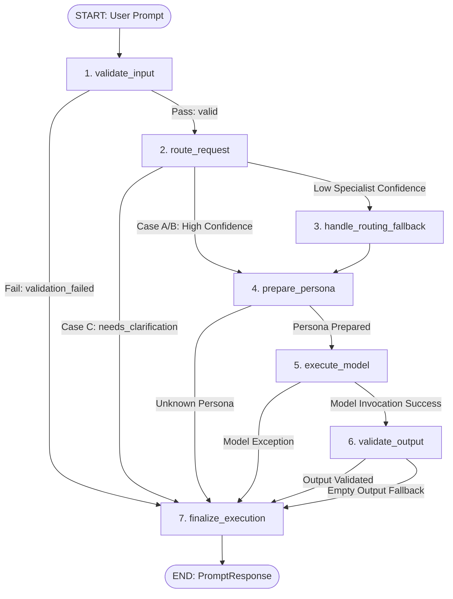

# Phase 3 Graph Workflow: LangGraph StateGraph Specification

This document provides a comprehensive technical specification of the **LangGraph StateGraph** powering the Octs AI orchestration pipeline, including state schemas, node operations, conditional decision edges, and lifecycle transitions.

---

## Table of Contents

- [Workflow Overview](#workflow-overview)
- [Typed Orchestration State](#typed-orchestration-state)
- [Graph Topology & Mermaid Workflow](#graph-topology--mermaid-workflow)
- [Node Inventory & Execution Logic](#node-inventory--execution-logic)
- [Conditional Edges & Decision Logic](#conditional-edges--decision-logic)
- [START and END Transitions](#start-and-end-transitions)
- [Recursion Limits & Safety Guards](#recursion-limits--safety-guards)

---

## Workflow Overview

The Octs AI LangGraph workflow is an explicit state machine assembled with `langgraph.graph.StateGraph`. It manages the entire lifecycle of a creative prompt from intake through persona specialization, model execution, quality verification, and output finalization.

### Core Architectural Guarantees
- **Type Safety**: Enforced via Python `TypedDict` (`OrchestrationState`).
- **Deterministic Branching**: Governed by pure conditional edge functions.
- **Controlled Short-Circuiting**: Invalid inputs or ambiguous discipline queries exit early without wasting LLM compute.
- **Cyclic Recovery Prepared**: Node topology is structured to support multi-turn reflection and revision loops in Phase 4.

---

## Typed Orchestration State

The graph state is defined in [`backend/orchestration/state.py`](file:///Users/samriddha/Documents/Octs/backend/orchestration/state.py) using Python's `typing.TypedDict`. Every node receives the current state and returns a dictionary of updated keys, which LangGraph merges immutably.

```python
class OrchestrationState(TypedDict, total=False):
    # 1. Request Identification & Session
    request_id: str                      # Unique UUID for distributed request tracing
    session_id: Optional[str]            # Conversational thread or session ID
    started_at: float                    # Monotonic clock timestamp (time.perf_counter)
    completed_at: Optional[float]        # Epoch completion timestamp

    # 2. Intake & Classification Context
    original_prompt: str                 # Raw user prompt text
    discipline_id: Optional[str]         # Active creative discipline (writers, musicians, etc.)
    task_type: Optional[str]             # Explicit task category override
    selected_persona_id: Optional[str]   # Routed specialist persona ID
    persona_name: Optional[str]          # Human-readable specialist persona name
    routing_confidence: float            # Heuristic routing confidence (0.0 to 1.0)
    routing_rationale: str               # Explanatory text for persona selection

    # 3. Model Preparation & Execution
    formatted_messages: List[BaseMessage] # Compiled LangChain System and Human messages
    model_name: str                      # Model name utilized (e.g. gemini-3.5-flash-lite)
    raw_response: Optional[str]          # Unprocessed LLM response text
    generated_output: str                # Verified final creative output

    # 4. Clarification, Status & Telemetry
    needs_clarification: bool            # True if discipline is ambiguous (Case C)
    clarification_question: Optional[str]# Concise clarification prompt for the user
    execution_status: str                # Execution lifecycle status code
    execution_error: Optional[str]       # Error message if failure occurred
    recovery_attempts: int               # Count of autonomous self-correction loops
    latency_ms: int                      # Server-measured execution latency in ms
```

---

## Graph Topology & Mermaid Workflow



---

## Node Inventory & Execution Logic

The pipeline comprises 7 deterministic execution nodes defined in [`backend/orchestration/nodes.py`](file:///Users/samriddha/Documents/Octs/backend/orchestration/nodes.py):

### 1. `validate_input_node`
- **Purpose**: Validates prompt length, non-empty content, and discipline strings.
- **Rules**:
  - Rejects empty prompts or strings containing solely whitespace.
  - Rejects oversized prompts exceeding 50,000 characters.
  - Normalizes allowed disciplines (`writers`, `musicians`, `creators`, `designers`). Leaves discipline as `None` if unassigned.
- **Success Outcome**: Updates `execution_status = "validated"`.
- **Failure Outcome**: Sets `execution_status = "validation_failed"`, updates `execution_error`.

### 2. `route_request_node`
- **Purpose**: Evaluates user prompt against craft keywords and task heuristics via injected `AgentRouter`.
- **4-Case Routing Logic**:
  - **Case A**: High confidence ($\ge 0.70$) matching exact specialist -> `execution_status = "routed"`.
  - **Case B**: Low specialist confidence, but known discipline -> triggers `routing_fallback`.
  - **Case C**: Ambiguous query with no explicit discipline -> sets `needs_clarification = True`, `execution_status = "needs_clarification"`.
  - **Case D**: Unknown discipline -> safe fallback.
- **Outcome**: Populates `selected_persona_id`, `persona_name`, `routing_confidence`, and `routing_rationale`.

### 3. `handle_routing_fallback_node`
- **Purpose**: Safely resolves low-confidence specialist queries within a known discipline.
- **Logic**: Selects the primary lead persona for that discipline (e.g. `narrative_architect` for writers, `track_structure_architect` for musicians, `hook_retention_architect` for creators, `concept_ideation_engine` for designers).
- **Outcome**: Sets `execution_status = "routed"`, `routing_confidence = 0.50`, rationale indicates primary discipline lead fallback.

### 4. `prepare_persona_node`
- **Purpose**: Compiles specialist craft prompt and constructs LangChain `BaseMessage` structures.
- **Logic**: Retrieves `PersonaDefinition` from `AgentRegistry`. Injects craft constraints, tone mandates, anti-patterns, and expected output format into `SystemMessage`. Wraps prompt in `HumanMessage`.
- **Outcome**: Populates `formatted_messages: List[BaseMessage]`.

### 5. `execute_model_node`
- **Purpose**: Invokes the configured Gemini model using explicit dependency injection.
- **Logic**: Takes injected `model` parameter. Passes `formatted_messages`. Extracts raw string content from `AIMessage`.
- **Error Handling**: Catches provider API exceptions (e.g. rate limits, quotas), updates `execution_status = "model_failed"`, records `execution_error`.

### 6. `validate_output_node`
- **Purpose**: Verifies model output against basic structure and completeness criteria.
- **Logic**: Ensures response is non-empty and non-whitespace. Sets `generated_output`.
- **Fallback**: If empty output is detected, injects a safe domain recovery message.

### 7. `finalize_execution_node`
- **Purpose**: Assembles execution telemetry, calculates latency, and sets terminal status.
- **Logic**:
  - Calculates `latency_ms = (perf_counter() - started_at) * 1000`.
  - If `needs_clarification` is True, assigns `generated_output = clarification_question` to preserve backward compatibility for `{ "reply": "..." }`.
  - Updates terminal status (`completed`, `completed_clarification_required`, `failed`).

---

## Conditional Edges & Decision Logic

Branching decisions are implemented in [`backend/orchestration/edges.py`](file:///Users/samriddha/Documents/Octs/backend/orchestration/edges.py):

### 1. `route_after_input_validation`
- Evaluates `state["execution_status"]`.
- Returns `"route_request"` if `"validated"`.
- Returns `"finalize_execution"` if `"validation_failed"`.

### 2. `route_after_task_routing`
- Evaluates routing status and confidence:
  - If `execution_status == "needs_clarification"` (Case C) -> `"finalize_execution"` **(Short-Circuits)**.
  - If `execution_status == "routing_fallback"` -> `"handle_routing_fallback"`.
  - If `execution_status == "routed"` -> `"prepare_persona"`.

### 3. `route_after_model_execution`
- Evaluates model execution status:
  - If `execution_status == "model_executed"` -> `"validate_output"`.
  - If `execution_status == "model_failed"` -> `"finalize_execution"`.

### 4. `route_after_output_validation`
- Evaluates output check:
  - Returns `"finalize_execution"` on valid output or handled fallback.

---

## START and END Transitions

LangGraph pipelines utilize reserved `START` and `END` sentinels from `langgraph.graph`:

```python
builder = StateGraph(OrchestrationState)

# Entry transition
builder.add_edge(START, "validate_input")

# Terminal transitions
builder.add_edge("finalize_execution", END)
```

1. **Intake Transition**: Calling `graph.invoke(initial_state)` places the initial state onto the `START` edge, dispatching immediately to `validate_input`.
2. **Terminal Transition**: All terminal paths (successful completion, validation failure, Case C clarification short-circuit, or model exception) route through `finalize_execution`, which exits cleanly to `END`.

---

## Recursion Limits & Safety Guards

To protect against unbounded execution loops in agentic workflows, execution is strictly bounded:

1. **Configured Recursion Limit**:
   - `Settings.max_recursion_limit` (default: 25).
   - Injected into graph execution config:
     ```python
     config = {
         "recursion_limit": self.settings.max_recursion_limit,
         "tags": ["octs-orchestration", role or "unspecified"],
         "metadata": {"request_id": request_id, "session_id": session_id}
     }
     final_state = self.graph.invoke(initial_state, config=config)
     ```
2. **Recovery Bounds**:
   - In Phase 3, recovery loops are bounded by deterministic node edges.
   - Max recovery cycles are bounded to prevent infinite re-prompting.
