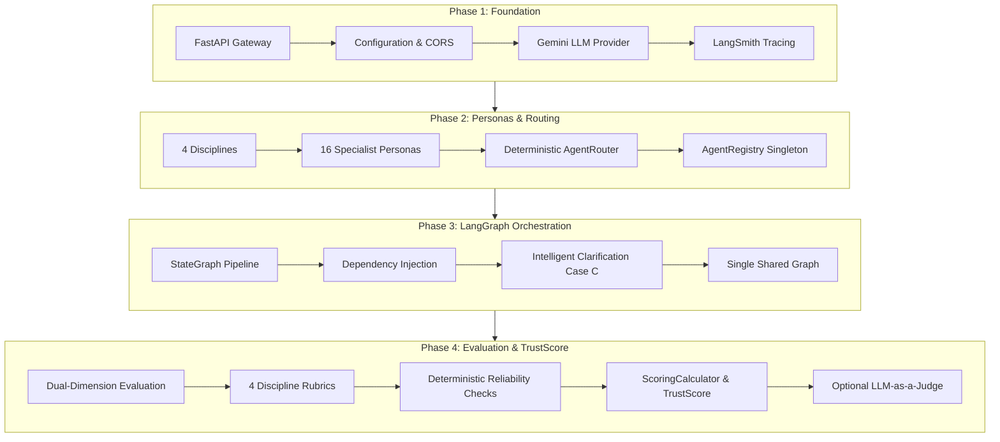
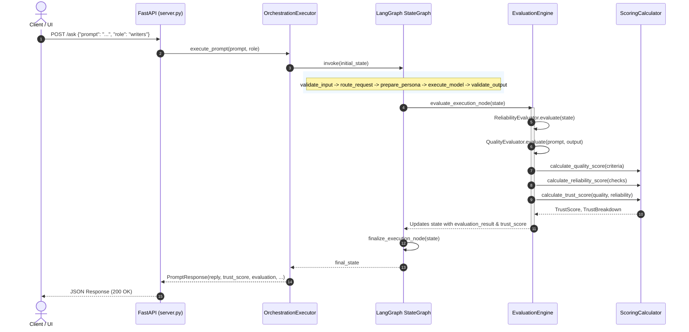

# OCTS AI — Phase 4: System Architecture & Design

## 1. Architectural Evolution (Phases 1 to 4)



---

## 2. Dual-Dimension Evaluation Architecture

The cornerstone of Phase 4 is the strict separation between **Creative Output Quality** and **Execution Reliability**.

```mermaid
graph TD
    A[Orchestration State] --> B{Execution Status?}
    B -->|needs_clarification| C[Clarification Short-Circuit]
    C --> D[Quality: None | Reliability: None | TrustScore: None | Status: skipped]
    
    B -->|execution_failed| E[Failure Handling]
    E --> F[Quality: None | Reliability: Evaluated | TrustScore: None]

    B -->|output_validated| G[Dual Dimension Evaluator]
    
    subgraph DimA["Dimension A: Creative Output Quality"]
        G --> H[Discipline Rubric Evaluator]
        H --> I[Heuristic Baseline or LLM Judge]
        I --> J[Normalized Quality Score: 0 - 100]
    end

    subgraph DimB["Dimension B: Execution Reliability"]
        G --> K[Deterministic Checks Runner]
        K --> L[Schema, Persona, Latency Invariants]
        L --> M[Deterministic Reliability Score: 0 - 100]
    end

    J --> N[ScoringCalculator]
    M --> N
    N --> O["Composite TrustScore = (Quality * 0.70) + (Reliability * 0.30)"]
```

### Why Independent Dimensions Matter
1. **Technical Success $\neq$ High Quality:** A model can return a syntactically valid JSON payload in 200 ms that contains generic, uninspired creative text. Conflating execution with quality would falsely assign high marks to poor creative work.
2. **Creative Value $\neq$ Technical Flawlessness:** A compelling script returned despite a non-critical telemetry warning or degraded retry loop is still creatively valuable, but its reliability deficit must remain visible to operators.
3. **No Fabricated Trust:** If an execution fails or user clarification is requested, creative quality is not evaluated and `trust_score` remains strictly `None`.

---

## 3. LangGraph Pipeline Integration

Evaluation is integrated directly into the compiled StateGraph as a dedicated node (`evaluate_execution`) positioned between `validate_output` and `finalize_execution`.



---

## 4. Module Boundaries & Responsibilities

| Module | Responsibility | Injected Dependencies |
| :--- | :--- | :--- |
| `backend.evaluation.engine.EvaluationEngine` | Coordinates quality assessment, reliability evaluation, mode routing, and defensive exception containment. | `EvaluatorRegistry`, `ScoringCalculator`, `ReliabilityEvaluator`, `LLMJudge`, `Settings` |
| `backend.evaluation.evaluator_registry.EvaluatorRegistry` | O(1) lookup of discipline quality evaluators; singleton provider. | None |
| `backend.evaluation.quality.base.QualityEvaluator` | Abstract base defining criterion weights, normalization, and domain constraints. | `weights_override` |
| `backend.evaluation.reliability.evaluator.ReliabilityEvaluator` | Runs 7 deterministic pipeline health checks against orchestration state. | `AgentRegistry` |
| `backend.evaluation.scoring.calculator.ScoringCalculator` | Calculates normalized Quality Score, Reliability Score, coverage, and composite TrustScore. | Configured weights (`0.70 / 0.30`) |
| `backend.evaluation.judges.llm_judge.LLMJudge` | Model-based structured evaluation with prompt-injection containment. | `BaseChatModel`, `timeout_seconds`, `max_retries` |
