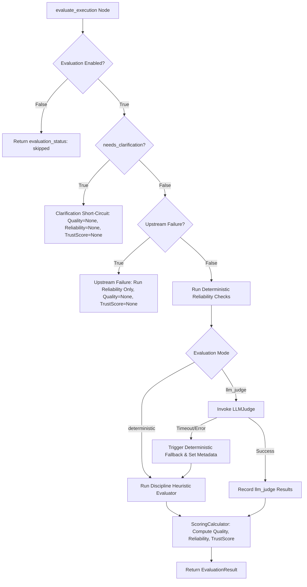

# OCTS AI — Phase 4: Evaluation Engine Deep Dive

## 1. Engine Lifecycle & Execution Flow

The `EvaluationEngine` (`backend/evaluation/engine.py`) coordinates independent assessment of creative quality and execution reliability. It is integrated into the compiled LangGraph StateGraph within the `evaluate_execution` node.

### Clarification Path Semantics (Fix 1)
When the router flags `needs_clarification = True`:
- `evaluation_status = "skipped"`
- `quality_score = None`, `reliability_score = None`, `trust_score = None`.
- `reliability_checks = []` (Zero fabricated checks).
- `evaluation_method = "skipped"`, `judge_status = "not_used"`.
- Bypasses model invocation and evaluation entirely.

---

## 2. LLM-as-a-Judge Fallback Transparency (Fix 3)

When operating in `llm_judge` or `hybrid` mode, the system exposes full execution metadata:

| Field | Type | Description |
| :--- | :--- | :--- |
| `evaluation_method` | `string` | The actual method producing the score: `"deterministic"` \| `"llm_judge"` \| `"hybrid"`. |
| `judge_status` | `string` | Operational status: `"not_used"` \| `"success"` \| `"timeout"` \| `"invalid_response"` \| `"error"` \| `"unavailable"`. |
| `fallback_triggered`| `boolean` | `true` if a judge failure caused fallback to deterministic heuristics. |
| `fallback_reason` | `string` | Sanitized explanation of the judge failure without leaking secrets or traces. |

### Fallback Guarantee
If the LLM judge times out, returns malformed JSON, or fails with a provider exception:
1. The generated creative response is **never destroyed or dropped**.
2. The engine falls back to deterministic craft heuristics.
3. `fallback_triggered` is set to `true`, and `fallback_reason` records the cause.

---

## 3. Prompt-Injection Defenses & Limitations (Fix 4)

### Defense-in-Depth Architecture
The LLM Judge protects evaluation integrity through layered defenses:
1. **XML Isolation:** Both user prompt and candidate text are enclosed inside `<original_prompt>` and `<candidate_output>` tags.
2. **Explicit Directives:** System prompt instructs the judge that enclosed content is untrusted data and forbids following instructions embedded inside the text.
3. **Pydantic Validation:** All responses are parsed into `JudgeRawResponse`.
4. **Extraneous Criterion Rejection:** The judge only accepts criterion IDs defined in the active discipline rubric. Injected or hallucinated criterion IDs are strictly dropped.
5. **Score Clamping:** Scores are validated within the range $0.0 - 100.0$.

### Explicit Security Boundary
XML delimiters provide structural separation and defense-in-depth, but **do not provide an absolute mathematical guarantee against advanced adversarial prompt injection.** OCTS AI treats prompt injection defenses as defense-in-depth, supported by schema validation and deterministic fallback boundaries.

---

## 4. Reliability Evaluation Audit (Fix 5)

Executes 7 deterministic invariants with deduplication:

1. `output_exists` (CRITICAL, -40): `generated_output` is a valid string.
2. `output_not_empty` (CRITICAL, -40): Output contains non-whitespace text.
3. `persona_resolved` (CRITICAL, -40): Persona identifier exists in `AgentRegistry`.
4. `persona_discipline_match` (WARNING, -10): Persona belongs to routed discipline.
5. `execution_successful` (CRITICAL, -40): Workflow traversed without unhandled node errors.
6. `latency_recorded` (INFO, -0): Request latency was measured ($> 0$).
7. `substantive_length` (WARNING, -10): Output length satisfies domain threshold ($\ge 25$ chars).

* Deduplication guarantees that duplicate check results cannot cause duplicate deductions.
* Skipped or unavailable checks do not count as passes.
