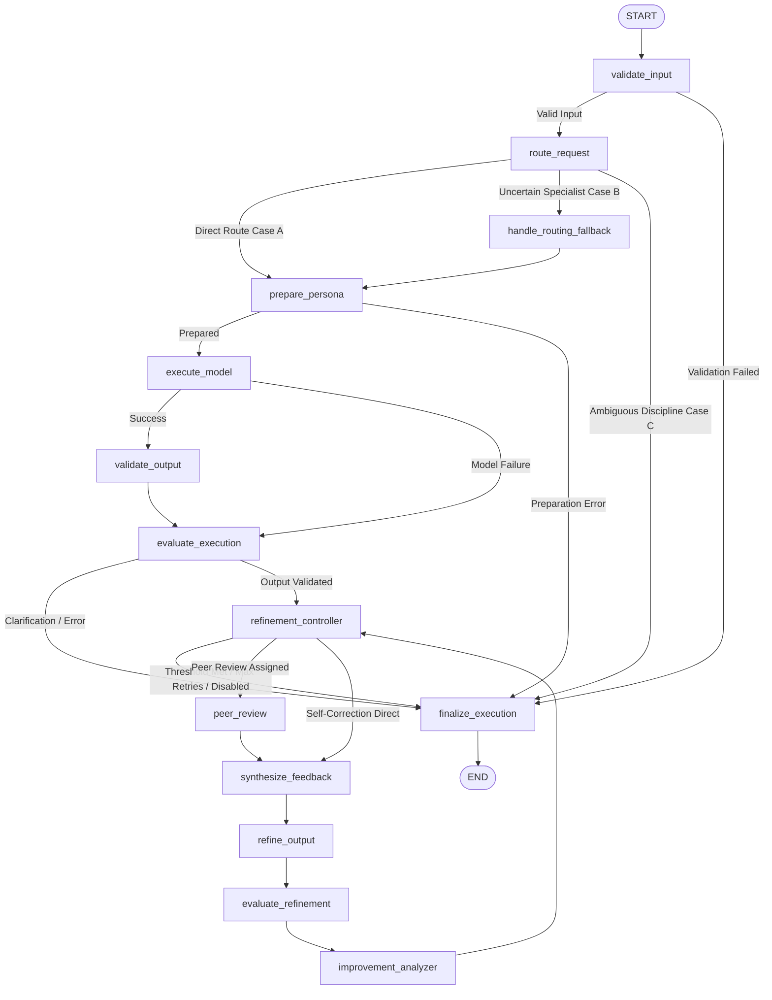

# OCTS AI — Phase 5: Architecture & LangGraph Workflow

## 1. Architectural Philosophy
Phase 5 introduces autonomous self-correction without compromising the architectural invariants established across Phases 1 through 4:
- **Single Shared StateGraph:** Avoids graph fragmentation. A single graph orchestrates all 16 specialists across all 4 disciplines.
- **Explicit Dependency Injection:** The LLM model, Router, Registry, EvaluationEngine, and RefinementEngine are injected into graph nodes as explicit parameters.
- **Defensive Regression Reversion:** Generated outputs are never blindly replaced. Re-evaluations must prove non-regression before a candidate is accepted.
- **Zero Runaway Recursion:** Iteration bounding is enforced at three distinct levels: the `RecoveryManager`, the `RefinementController`, and LangGraph's `recursion_limit` (configured to 25).

---

## 2. Complete LangGraph Orchestration Topology
The extended Phase 5 StateGraph execution topology:

---

## 3. Node Responsibilities

| Node Identifier | Execution Function | Architectural Responsibility |
| :--- | :--- | :--- |
| `validate_input` | `validate_input_node` | Enforces prompt string validation, whitespace checks, and max length bounds. |
| `route_request` | `route_request_node` | Dispatches prompt to discipline and specialist persona via classifier. |
| `handle_routing_fallback` | `handle_routing_fallback_node` | Assigns discipline lead persona when specialist is uncertain. |
| `prepare_persona` | `prepare_persona_node` | Compiles LangChain prompt template and domain constraints for persona. |
| `execute_model` | `execute_model_node` | Invokes injected LLM to generate initial creative output draft. |
| `validate_output` | `validate_output_node` | Validates structural non-emptiness of generated text. |
| `evaluate_execution` | `evaluate_execution_node` | Phase 4 EvaluationEngine assessing Quality, Reliability, and TrustScore. |
| `refinement_controller` | `refinement_controller_node` | Phase 5 decision engine: assesses threshold, attempts, and routing branch. |
| `peer_review` | `peer_review_node` | Invokes complementary specialist persona to generate structured critique. |
| `synthesize_feedback` | `synthesize_feedback_node` | Merges rubric weaknesses with peer recommendations into author directives. |
| `refine_output` | `refine_output_node` | Re-invokes author persona with synthesized refinement instructions. |
| `evaluate_refinement` | `evaluate_refinement_node` | Evaluates refined candidate using Phase 4 EvaluationEngine. |
| `improvement_analyzer` | `improvement_analyzer_node` | Compares evaluations, enforces regression reversion, selects best artifact. |
| `finalize_execution` | `finalize_execution_node` | Finalizes telemetry, formats `RefinementMetadata`, prepares response. |

---

## 4. State Transition Invariants
1. **Initial Artifact Preservation:** `initial_output` and `initial_evaluation` are permanently frozen on the first visit to `refinement_controller` and are never mutated.
2. **Current vs Best Output Separation:** `current_output` tracks the candidate produced by the latest attempt, while `best_output` holds the highest-scoring verified artifact.
3. **Monotonic Counter Increment:** `recovery_attempts` is incremented sequentially (0 -> 1 -> 2) by the controller and cannot exceed `max_recovery_attempts = 2`.
4. **Clean Exit Transitions:** If a model failure occurs during refinement, `improvement_analyzer` detects the failure, retains `best_output`, logs the incident, and loops back to controller where it terminates into `finalize_execution`.
