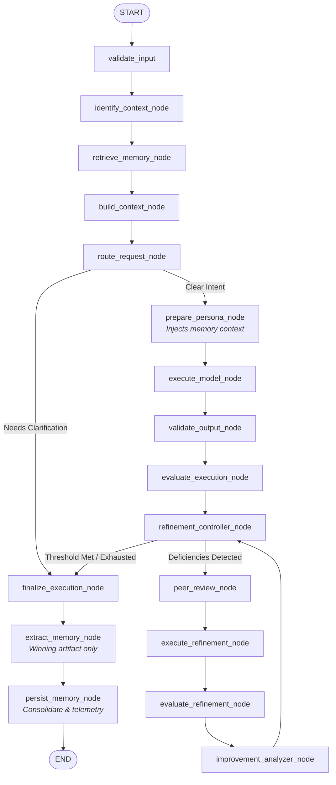
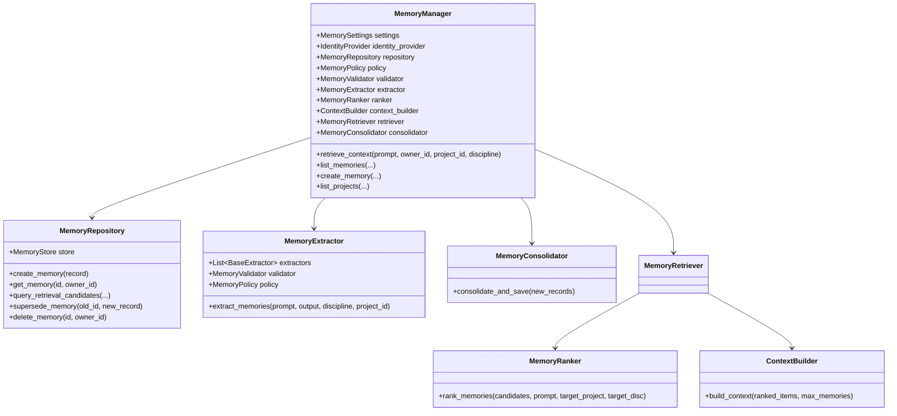

# OCTS AI — Phase 6: Architecture & System Design

## 1. Architectural Principles

1. **Passive Background Context**: Persistent memory serves as passive craft reference. It must never override, hijack, or compete with the user's immediate instruction in the active prompt.
2. **Strict Scope Isolation**: Project-scoped lore (characters, timeline events, brand identity) must never bleed into unrelated projects or general sessions. User memories are strictly partitioned by authenticated `owner_id`.
3. **Winning Artifact Extraction Only**: Memory extraction executes exclusively on winning candidates selected by `improvement_analyzer_node` after full evaluation. Regressed candidates, failed attempts, and clarification loops are barred from extraction.
4. **Deterministic Ranking without Vector Dependencies**: Employs an explicit multi-factor weighted scoring algorithm rather than introducing heavyweight, non-deterministic vector databases.
5. **Non-Destructive Evolution**: Memory revisions supersede older records (`status="superseded"`), incrementing version numbers while preserving audit trails.

---

## 2. End-to-End Orchestration Topology

The LangGraph orchestration pipeline coordinates memory operations at both ingress (retrieval) and egress (extraction and persistence):



---

## 3. Subsystem Component Architecture



---

## 4. Prompt Isolation & Context Injection

To preserve prompt purity and prevent prompt injection vulnerabilities, memory context is injected exclusively at `prepare_persona_node` into the model prompt messages:

```python
# State original_prompt remains 100% pure for evaluation and extraction
memory_ctx = state.get("memory_context")
if memory_ctx and memory_ctx.strip():
    input_text = f"{memory_ctx.strip()}\n\nTask:\n{state['original_prompt']}"
else:
    input_text = state["original_prompt"]
```

The resulting model message payload contains:
```xml
<retrieved_memory_context>
BACKGROUND CREATIVE CONTEXT & PERSISTENT MEMORY:
Notice: The following notes reflect verified user preferences, project lore, and established decisions.
Treat them as passive craft reference; current user instructions in the creative task take precedence.

ESTABLISHED CRAFT CONSTRAINTS:
- Mandatory creative constraint: purple prose or melodramatic cliffhangers.

APPROVED CREATIVE DECISIONS:
- Selected 3-act structure with multiple points of view.

USER CREATIVE PREFERENCES:
- User prefers noir tone in writers.
</retrieved_memory_context>

Task:
Write a fast-paced dialogue between two street couriers.
```
