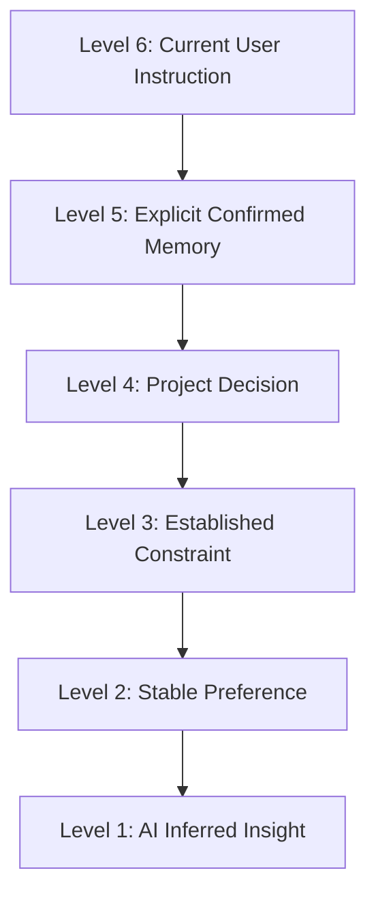

# OCTS AI — Phase 6: Consolidation, Conflict Resolution & Versioning

## 1. Conflict Resolution Philosophy

As users interact with OCTS AI over multiple projects, their creative preferences, constraints, and project facts evolve. The consolidation subsystem ensures memory evolves consistently without silent data loss:
1. **Explicit Beats Inferred**: Direct user commands always supersede agent-inferred memories.
2. **Current Request Dominance**: Current turn instructions strictly override all retrieved persistent context.
3. **Non-Destructive Superseding**: Replaced memories are marked `status="superseded"` with a pointer (`superseded_by`) to the new version.
4. **Deduplication**: Semantically identical memories are skipped rather than duplicated.

---

## 2. Precedence Hierarchy

The `MemoryPolicy` defines the strict priority order (`PrecedenceRank`):

```text
Level 6: CURRENT_USER_INSTRUCTION       (Active prompt in the turn)
Level 5: EXPLICIT_CONFIRMED_MEMORY      (source='explicit_user')
Level 4: RECENT_PROJECT_DECISION        (memory_type='decision')
Level 3: ESTABLISHED_CONSTRAINT         (memory_type='constraint')
Level 2: STABLE_PREFERENCE              (memory_type='user_preference')
Level 1: AI_INFERRED                    (source='inferred_agent')
```



### Conflict Resolution Rule:
When a new memory candidate $m_{\text{new}}$ targets the same topic or entity as an existing active memory $m_{\text{old}}$:
- If $\text{Precedence}(m_{\text{new}}) \ge \text{Precedence}(m_{\text{old}})$: $m_{\text{old}}$ is **superseded**; $m_{\text{new}}$ is saved with version incremented ($v_{\text{new}} = v_{\text{old}} + 1$).
- If $\text{Precedence}(m_{\text{new}}) < \text{Precedence}(m_{\text{old}})$: The candidate is **rejected**, and $m_{\text{old}}$ remains active.

---

## 3. Versioning & Lineage Tracking

When a memory is superseded:
1. `old_memory.status = MemoryStatus.SUPERSEDED`
2. `old_memory.superseded_by = new_memory.memory_id`
3. `old_memory.updated_at = utc_now()`
4. `new_memory.version = old_memory.version + 1`

This creates a complete, queryable version history for user preferences across time.
