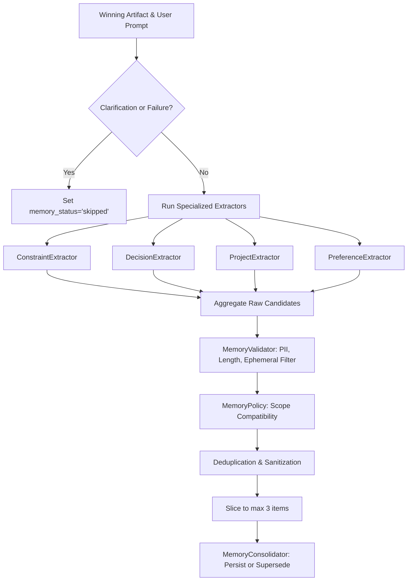

# OCTS AI — Phase 6: Memory Extraction Pipeline

## 1. Conservative Extraction Principles

Memory extraction creates durable craft records from user interactions. Because false positives degrade retrieval quality over time, the extraction subsystem operates under four conservative principles:

1. **Winning Artifact Exclusivity**: Extraction is invoked only on the winning artifact selected by the `improvement_analyzer_node`. Intermediate drafts, regressed candidates, and abandoned refinement attempts are never inspected.
2. **Execution Gate**: If `needs_clarification=True`, or `execution_status in ("failed", "validation_failed", "execution_failed")`, extraction is completely bypassed (`memory_status="skipped"`).
3. **Turn Bounding**: The system enforces a strict ceiling of at most **3 extracted memories per interaction turn** (`max_extract_per_turn = 3`).
4. **PII and Secret Scrubbing**: All candidate content passes through `MemoryValidator`, rejecting credit card numbers, Social Security Numbers, and API key patterns.

---

## 2. Extraction Pipeline Architecture

---

## 3. Specialized Extractor Specifications

### A. `ConstraintExtractor`
- **Target**: Explicit negative rules, style prohibitions, and structural limits.
- **Patterns**:
  * `(?i)\b(?:never use|do not use|avoid using|avoid all)\s+([^.?!;\n]{4,80})`
  * `(?i)\b(?:must always (?:contain|include|adhere to|pass))\s+([^.?!;\n]{4,80})`
  * `(?i)\b(?:strict constraint:\s*|rule:\s*)\s*([^.?!;\n]{4,80})`
- **Output Record**: `memory_type=CONSTRAINT`, `confidence=0.95`, `importance=0.90`.

### B. `DecisionExtractor`
- **Target**: Creative directions, chosen structures, and approved concepts.
- **Patterns**:
  * `(?i)\b(?:we have decided to|let's go with|i've decided on)\s+([^.?!;\n]{5,100})`
  * `(?i)\b(?:approved (?:concept|direction|palette|structure) is)\s+([^.?!;\n]{5,100})`
- **Output Record**: `memory_type=DECISION`, `confidence=0.90`, `importance=0.85`.

### C. `ProjectExtractor`
- **Target**: Character names, world lore, target audience, brand names.
- **Patterns**:
  * `(?i)\b(?:the protagonist is)\s+([A-Z][a-zA-Z\s]{1,40})`
  * `(?i)\b(?:the project (?:title|name) is)\s*['\"]?([^.?!,;\n]{3,80})['\"]?`
  * `(?i)\b(?:our target audience is)\s+([^.?!;\n]{5,100})`
- **Output Record**: `memory_type=PROJECT`, `scope=PROJECT`, `confidence=0.90`.

### D. `PreferenceExtractor`
- **Target**: Stable creative tastes, voice preferences, and aesthetic styles.
- **Patterns**:
  * `(?i)\b(?:i prefer|my preference is)\s+([^.?!,;\n]{4,80})`
  * `(?i)\b(?:i always (?:want|use|like|prefer))\s+([^.?!,;\n]{4,80})`
  * `(?i)\b(?:my (?:favorite|preferred) (?:tone|style|genre) is)\s+([^.?!,;\n]{4,80})`
- **Output Record**: `memory_type=USER_PREFERENCE`, `confidence=0.95`, `importance=0.85`.

---

## 4. Rejection of Ephemeral Conversational Commands

The validator automatically rejects ephemeral conversational commands from becoming permanent memories:
- "Please help me write a story about a dragon."
- "Hello, can you give me some ideas for a song?"
- "Fix the typo in paragraph 2."
- "Summarize this text in 5 bullet points."
