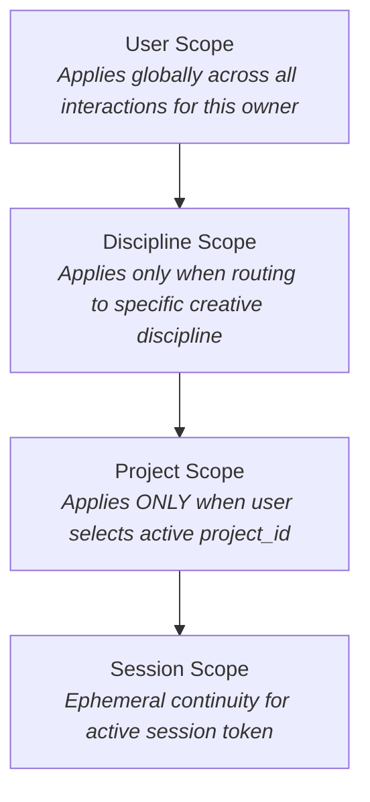

# OCTS AI — Phase 6: Memory Data Model & Taxonomy

## 1. Core Memory Taxonomy

OCTS AI classifies all persistent intelligence into five explicit semantic types:

| Memory Type | Value | Scope | Description | Typical Content |
|---|---|---|---|---|
| **User Preference** | `user_preference` | User / Discipline | Stable aesthetic or craft tendencies. | "User prefers concise dialogue with dark comedic subtext." |
| **Project** | `project` | Project | Character dossiers, world lore, target audience. | "Protagonist is Marcus Vance, an orbital communications engineer." |
| **Decision** | `decision` | Project / Discipline | Approved creative directions or structures. | "We decided to use a 3-act structure with dual points of view." |
| **Constraint** | `constraint` | User / Project / Discipline | Hard negative or positive craft boundaries. | "Never use passive voice or melodramatic cliffhangers." |
| **Interaction Context** | `interaction_context` | Session | Ephemeral conversational continuity. | "Current chapter focuses on the fallout from the bank heist." |

---

## 2. Memory Scopes & Access Boundaries

Every memory record is bound to a strict hierarchical scope:



### Scope Isolation Invariants:
1. **User Isolation**: A query with `owner_id="user_A"` can NEVER retrieve records where `owner_id="user_B"`.
2. **Project Isolation**: A query with `project_id="proj_alpha"` can NEVER retrieve records where `scope="project"` and `project_id="proj_beta"`.
3. **Discipline Neutrality**: Universal preferences (`discipline=None` or `scope="user"`) are available across disciplines, whereas discipline-specific memories (`scope="discipline"`) require a matching target discipline.

---

## 3. Schemas & Enums

### `MemoryStatus`
- `active`: Eligible for retrieval and candidate ranking.
- `archived`: Retained for audit/history; excluded from active prompts.
- `superseded`: Replaced by a newer version through conflict resolution.
- `deleted`: Soft-deleted by user directive.

### `MemorySource`
- `explicit_user`: Direct user command or stated preference (Precedence 5).
- `inferred_agent`: Derived by extraction heuristics from craft output (Precedence 1–2).
- `system_rule`: Default discipline rules (Precedence 3).
- `consolidated`: Synthesized or merged through deduplication.

### `MemoryRecord` Pydantic Model
```python
class MemoryRecord(BaseModel):
    memory_id: str = Field(default_factory=lambda: str(uuid.uuid4()))
    owner_id: str
    memory_type: MemoryType
    scope: MemoryScope
    discipline: Optional[str] = None
    project_id: Optional[str] = None
    session_id: Optional[str] = None
    content: str
    structured_data: Dict[str, Any] = Field(default_factory=dict)
    source: MemorySource = MemorySource.EXPLICIT_USER
    confidence: float = Field(default=0.85, ge=0.0, le=1.0)
    importance: float = Field(default=0.70, ge=0.0, le=1.0)
    created_at: datetime = Field(default_factory=utc_now)
    updated_at: datetime = Field(default_factory=utc_now)
    last_accessed_at: Optional[datetime] = None
    access_count: int = 0
    status: MemoryStatus = MemoryStatus.ACTIVE
    version: int = 1
    superseded_by: Optional[str] = None
```
