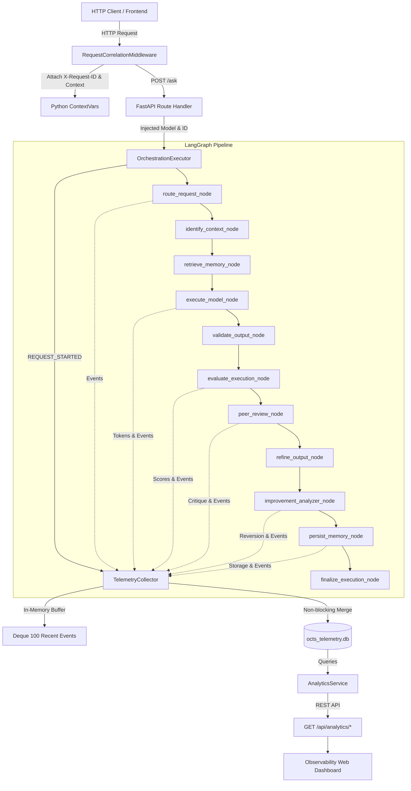

# Phase 7 — Observability Architecture

## Architectural Philosophy
Observability in OCTS AI follows three strict rules:
1. **Instrument, Do Not Rebuild**: The existing LangGraph orchestration, evaluation rubrics, refinement loops, and memory stores remain intact. Observability acts as a non-invasive telemetry overlay.
2. **Failures in Observability Are Non-Fatal**: If telemetry logging or metric recording fails, the user's creative generation request must never crash or degrade.
3. **Strict Separation of Telemetry & Domain State**: Operational metrics and logs are stored in a dedicated SQLite database (`octs_telemetry.db`), completely separate from creative persistence (`octs_memory.db`).

## Package Structure
```text
backend/observability/
├── __init__.py           # Unified exports facade
├── context.py            # Python contextvars for request isolation
├── correlation.py        # UUID generation, validation regex, header resolver
├── events.py             # 24 lifecycle events enum and ExecutionEvent model
├── logger.py             # Structured JSON formatter with credential scrubbing
├── models.py             # SQLAlchemy ORM models with composite indexes
├── storage.py            # TelemetryStore managing SQLite engine and pruning
├── metrics.py            # Math percentiles (P50, P95, P99) and token extraction
├── collector.py          # TelemetryCollector singleton with rolling buffer
├── middleware.py         # Starlette/FastAPI RequestCorrelationMiddleware
├── error_tracking.py     # 14-code ErrorTaxonomy, AppError, exception classifier
├── health.py             # HealthChecker (liveness, readiness, detailed)
├── analytics.py          # AnalyticsService querying persisted telemetry
└── schemas.py            # Pydantic v2 schemas for health, telemetry, analytics
```

## Telemetry Data Flow Diagram


