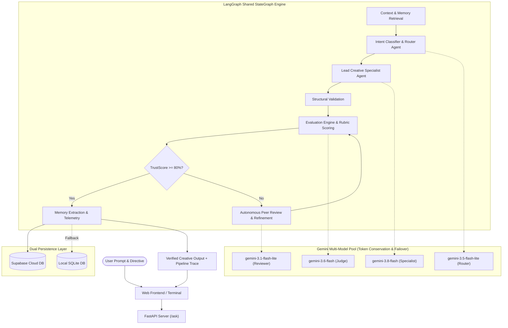

# OCTS AI 🚀
### Autonomous Multi-Agent Creative Harness & Orchestration Platform

[](https://www.python.org/)
[](https://fastapi.tiangolo.com/)
[](https://langchain-ai.github.io/langgraph/)
[](https://ai.google.dev/)
[](https://supabase.com/)
[]()
[](LICENSE)

**OCTS AI** is a state-of-the-art multi-agent creative orchestration harness designed to transform unpredictable AI generation into structured, verifiable, and resilient creative production. Powered by **LangGraph**, **FastAPI**, **Google Gemini**, and **Supabase**, OCTS AI coordinates 16 specialized agent personas across 4 creative disciplines with automatic failure recovery, independent craft evaluation, persistent memory, and intelligent multi-model token quota protection.

Repository: **[https://github.com/samcore07/octs-ai](https://github.com/samcore07/octs-ai)**

---

## 🌟 Key Highlights

### 1. 🤖 4 Creative Disciplines & 16 Specialized Sub-Agents
Unlike generic chat assistants, OCTS AI divides creative challenges across four distinct professional domains, each powered by a dedicated four-agent cohort:
* **✍️ Writers & Storytellers:** Narrative pacing, 3-act tension, lore consistency, subtext-rich dialogue, and research verification.
* **🎵 Musicians & Singers:** Syllabic meter, rhyme schemes, modal harmonic arrangement, song timelines, and sonic palette curation.
* **🎬 Content Creators:** Retention hooks, multi-platform script transmuting, 30-day editorial batching, and audience friction auditing.
* **🎨 Visual Artists & Designers:** Divergent concept moodboarding, typographic scale & baseline grid auditing, art direction critique, and accessible design token architecting.

### 2. ⚡ Mode-Based Automatic Cohort Activation (Zero Manual Deployment)
* Selecting any creative discipline automatically activates its **4 specialized cohort agents** (`● Active`).
* All 12 specialists belonging to the other 3 disciplines are seamlessly placed on `● Standby`.
* No complex manual agent routing or fragile deployment buttons—the harness automatically engages the lead specialist and coordinates peer reviewers based on input intent.

### 3. 🛡️ Resilient Gemini Free Model Pool & Token Quota Protection
To prevent rate limits (`HTTP 429 / ResourceExhausted`) and token quota exhaustion on the free tier, OCTS AI introduces a **parallelized multi-model dispatcher** distributing stages across 4 distinct Google Gemini models:
* **`gemini-3.8-flash`**: Primary creative generation and structural synthesis.
* **`gemini-3.5-flash-lite`**: Fast intent routing, constraint binding, and ambiguity detection.
* **`gemini-3.6-flash`**: Independent craft quality evaluation & TrustScore rubric judge.
* **`gemini-3.1-flash-lite`**: Autonomous peer review, subtext verification, and refinement generation.
* **Automated Failover:** If any model encounters token or rate limits, the dispatcher catches the exception and immediately falls back to the next available free model in the pool without dropping execution.

### 4. 🔍 Live Multi-Agent Orchestration & Model Trace
* Directly below the output canvas, an interactive **Multi-Agent Orchestration & Model Trace** panel renders step-by-step telemetry for every request:
  * Router classification confidence & craft constraint binding.
  * Lead specialist generation latency, prompt tokens, and completion tokens.
  * Evaluator rubric scoring & TrustScore %.
  * Peer reviewer consistency & cadence verification.

### 5. 🧠 Dual-Layer Persistent Memory (Supabase Cloud + Local SQLite)
* Seamless integration with **Supabase PostgreSQL** via PostgREST API for storing project contexts, craft constraints, and operational telemetry.
* **Defensive Fallback:** If cloud credentials are not supplied or the remote network is unreachable, OCTS AI gracefully and automatically degrades to local SQLite (`sqlite:///./octs_memory.db`) with zero downtime.

### 6. ⚖️ Independent TrustScore & Autonomous Refinement
* Evaluates creative output quality and execution reliability as two independent dimensions.
* If initial generation scores below quality thresholds, the harness triggers autonomous peer review loops (up to 2 bounded recovery attempts) to polish pacing, remove exposition, and ensure domain canon.
* **Regression Protection:** If a refinement regresses in quality, the system automatically reverts to the superior initial draft.

### 7. 📜 Session History & Answer Archive
* All prompts, generated answers, active persona badges, latency metrics, and full multi-agent traces are saved to local persistent storage (`octs_creative_history`).
* Users can search, copy, clear, or restore past outputs and their respective multi-agent traces directly to the live canvas in a single click.

---

## 🏛️ System Architecture



---

## 👥 Agent Roster & Discipline Matrix

| Discipline | Agent Persona | Assigned Role | Capabilities | Primary Model |
| :--- | :--- | :--- | :--- | :--- |
| **Writers** | **Narrative Architect** | Lead Specialist | 3-Act Beats, Pacing Tension, Character Stakes | `gemini-3.8-flash` |
| **Writers** | **Lore & Continuity Keeper** | Peer Reviewer | Magic/Tech Systems, Canon Memory, Timeline Paradoxes | `gemini-3.1-flash-lite` |
| **Writers** | **Prose Stylist & Dialogue Doctor** | Refinement | Subtext Injection, Dialogue Realism, Sensory Metaphors | `gemini-3.1-flash-lite` |
| **Writers** | **Research & Fact Scout** | Domain Context | Historical Authenticity, Accurate Terminology | `gemini-3.5-flash-lite` |
| **Musicians** | **Lyricist & Meter Engine** | Lead Specialist | Syllable Cadence, Rhyme Schemes, Vocal Resonance | `gemini-3.8-flash` |
| **Musicians** | **Harmonic Arranger** | Music Theorist | Modal Interchange, Secondary Dominants, Voice Leading | `gemini-3.8-flash` |
| **Musicians** | **Track Structure Architect** | Arranger | Tension Drops, Bridge Contrast, Arrangement Timelines | `gemini-3.8-flash` |
| **Musicians** | **Sonic Palette Curator** | Sound Designer | Genre Fusion, Acoustic/Analog Timbre, Spatial Mix | `gemini-3.5-flash-lite` |
| **Creators** | **Hook & Retention Architect** | Lead Specialist | First 3s Hooks, Curiosity Gaps, Drop-off Auditing | `gemini-3.8-flash` |
| **Creators** | **Multi-Platform Transmuter** | Adaptor | Longform to Vertical Script, X Threads, Newsletters | `gemini-3.8-flash` |
| **Creators** | **Editorial Cadence Planner** | Strategist | 30-Day Content Calendars, Batching Schedules | `gemini-3.8-flash` |
| **Creators** | **Audience Friction Auditor** | Reviewer | Cognitive Load Reduction, CTA Optimization | `gemini-3.1-flash-lite` |
| **Designers** | **Concept Ideation Engine** | Lead Specialist | Cross-Disciplinary Visual Metaphors, Moodboard Themes | `gemini-3.8-flash` |
| **Designers** | **Visual System Auditor** | Layout Critic | Modular Typographic Scales, Baseline Grids, Balance | `gemini-3.1-flash-lite` |
| **Designers** | **Art Direction Critic** | Quality Judge | Negative Space, Lighting Dynamics, Visual Hierarchy | `gemini-3.6-flash` |
| **Designers** | **Design Token & Palette Architect**| Systems Designer | APCA / WCAG AAA Contrast, Semantic Color Scales | `gemini-3.8-flash` |

---

## 🛠️ Tech Stack

* **Backend Framework:** FastAPI, Uvicorn, Pydantic v2
* **Multi-Agent Orchestration:** LangGraph, LangChain Core
* **Language Models:** Google Gemini API (`gemini-3.8-flash`, `gemini-3.5-flash-lite`, `gemini-3.6-flash`, `gemini-3.1-flash-lite`) via `langchain-google-genai`
* **Databases:** Supabase Cloud PostgreSQL, PostgREST API, SQLite3 / SQLAlchemy
* **Testing:** Pytest, AnyIO, Starlette TestClient (266 automated tests)
* **Frontend:** Modern Vanilla JavaScript (ES6+), Semantic HTML5, CSS Variables with Light/Dark theme persistence

---

## 🚀 Getting Started

### Prerequisites
* **Python 3.11** or **Python 3.12**
* **Google Gemini API Key** (obtainable from [Google AI Studio](https://aistudio.google.com/))
* *(Optional)* **Supabase Account & Project** for cloud persistence (defaults to local SQLite if unconfigured)

### Installation

1. **Clone the repository:**
   ```bash
   git clone https://github.com/samcore07/octs-ai.git
   cd octs-ai
   ```

2. **Create and activate a virtual environment:**
   ```bash
   python3 -m venv venv
   source venv/bin/activate  # On Windows: venv\Scripts\activate
   ```

3. **Install dependencies:**
   ```bash
   pip install -r requirements.txt
   ```

4. **Configure environment variables:**
   Create a `.env` file in the root directory:
   ```env
   # Gemini API Credentials
   GEMINI_API_KEY=your_gemini_api_key_here
   MODEL_NAME=gemini-3.5-flash-lite
   MODEL_PROVIDER=google_genai
   MODEL_TEMPERATURE=0.0

   # Observability (Optional)
   LANGSMITH_TRACING=false
   LANGSMITH_API_KEY=your_langsmith_key
   LANGSMITH_PROJECT=octs-ai

   # Supabase Cloud Database (Optional - falls back to local SQLite if empty)
   SUPABASE_URL=https://kmjuiutmuhhwkqnrncrs.supabase.co
   SUPABASE_KEY=your_supabase_anon_or_service_role_key
   ```

5. **Start the application:**
   ```bash
   uvicorn server:app --host 127.0.0.1 --port 8000 --reload
   ```

6. **Open in browser:**
   Navigate to [http://127.0.0.1:8000](http://127.0.0.1:8000) to access the interactive creative harness.

---

## 🧪 Testing & Verification

OCTS AI maintains a comprehensive test suite of **266 automated tests** verifying every layer of the platform:

```bash
# Run the full test suite
python3 -m pytest backend/tests/ -v

# Run targeted test suites
python3 -m pytest backend/tests/test_api.py -v                    # API & Endpoint verification
python3 -m pytest backend/tests/test_agent_routing.py -v          # Persona classifier & routing
python3 -m pytest backend/tests/test_orchestration_execution.py -v # LangGraph execution
python3 -m pytest backend/tests/test_supabase_integration.py -v   # Supabase cloud persistence
python3 -m pytest backend/tests/test_refinement_integration.py -v # Autonomous self-healing
```

---

## 📡 REST API Reference

| Method | Endpoint | Description |
| :--- | :--- | :--- |
| `POST` | `/ask` | Primary execution endpoint. Orchestrates agents, invokes multi-model pool, evaluates TrustScore, and returns verified creative output + pipeline trace. |
| `GET` | `/api/health` | Comprehensive system health check: model readiness, uptime, database provider, and LangSmith status. |
| `GET` | `/api/health/live` | Kubernetes / process liveness probe. |
| `GET` | `/api/health/ready` | Operational readiness probe (verifies required dependencies). |
| `GET` | `/api/models/pool` | Returns status of the 4 Gemini pool models, stage allocations, and token failover protection. |
| `GET` | `/api/supabase/status` | Reports cloud Supabase connection state, active database URL, and fallback status. |
| `POST`| `/api/supabase/test` | Triggers a live read/write verification test against the connected database. |
| `GET` | `/api/analytics/overview` | Returns operational analytics: total requests, average latency, P95 latency, error rate, and average TrustScore. |
| `GET` | `/api/analytics/requests` | Fetches historical request telemetry with filtering by discipline, persona, and time. |
| `GET` | `/api/analytics/personas` | Provides per-persona throughput, latency, and quality distributions. |
| `GET` | `/api/memory` | Retrieves user and project-scoped persistent memory records. |
| `POST`| `/api/memory` | Creates a new craft guideline or memory record. |
| `GET` | `/api/memory/projects` | Lists all active creative projects. |

---

## 📁 Repository Structure

```
octs-ai/
├── backend/
│   ├── agents/                   # 16 Specialized personas & central registry
│   │   ├── personas/             # Discipline-specific persona definitions
│   │   ├── routing/              # Intent classifier & fallback logic
│   │   └── registry.py           # Persona lookup & registry singleton
│   ├── evaluation/               # Independent Quality & Reliability evaluators
│   │   ├── rubrics/              # Craft rubric scoring definitions
│   │   ├── judges/               # Deterministic and LLM judge evaluators
│   │   └── engine.py             # EvaluationEngine & TrustScore calculator
│   ├── memory/                   # Dual persistence memory manager
│   │   ├── store.py              # SQLite storage backend
│   │   └── memory_manager.py     # Persistent memory coordinator
│   ├── models/                   # Gemini Multi-Model Pool & Token Manager
│   │   └── model_pool.py         # Multi-model dispatcher & 429 failover engine
│   ├── observability/            # Operational telemetry & analytics services
│   ├── orchestration/            # LangGraph StateGraph implementation
│   │   ├── graph.py              # Compiled StateGraph workflow definition
│   │   ├── nodes.py              # Explicit dependency-injected graph nodes
│   │   └── executor.py           # High-level OrchestrationExecutor
│   ├── refinement/               # Autonomous recovery & peer review engine
│   ├── tests/                    # 266+ Pytest unit and integration tests
│   ├── config.py                 # Pydantic Settings configuration
│   ├── schemas.py                # Request & response validation models
│   └── supabase_client.py        # Supabase cloud database client
├── pages/                        # Auxiliary UI views (Efficiency, Success, Agents, etc.)
│   ├── agents.html               # 16-Agent directory with cohort mode indicators
│   ├── efficiency.html           # Live latency and operational efficiency
│   ├── success.html              # Real-time TrustScore & quality metrics
│   ├── failures.html             # Autonomous recovery & failure intelligence
│   ├── observability.html        # Telemetry events & log streaming
│   ├── memory.html               # Persistent memory records & project context
│   └── js/                       # Dedicated controller scripts for pages
├── index.html                    # Main creative dashboard & execution canvas
├── script.js                     # Core frontend harness controller & trace renderer
├── style.css                     # Design system, theme variables, and trace styling
├── server.py                     # FastAPI application entrypoint & REST API
├── requirements.txt              # Production Python package requirements
└── README.md                     # Comprehensive platform documentation
```

---

## 📄 License

This project is licensed under the **MIT License**. See the [LICENSE](LICENSE) file for details.
